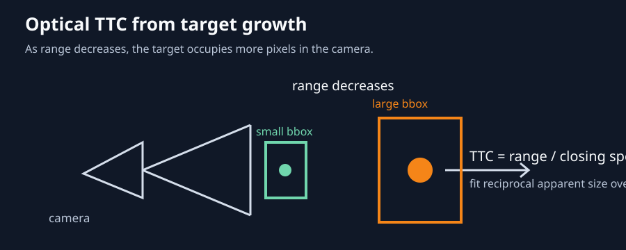

# TTC filter evaluation and application integration

## TTC idea

Time to contact (TTC) estimates how long remains before the vehicle reaches a
target. For a target with approximately constant physical size, its apparent
image size grows as range decreases:

```text
apparent_size ≈ focal_length × target_size / range
TTC ≈ range / closing_speed
```

The current estimator fits the reciprocal apparent size over a recent history
window. It must use only present and past measurements during flight. Ground
truth is available only for retrospective evaluation.



The target grows in the image as range decreases. The estimator converts that
growth into a time prediction, then the filter removes measurement spikes while
preserving the downward trend toward contact.

## Data and evaluation pipeline

1. Load raw tracking bbox samples from `recordings/tracking-replay.csv` or the
   `tracking/front/bbox` telemetry in the MCAP SQLite sidecar.
2. Convert bbox width and height to apparent size using `sqrt(width * height)`.
3. Recalculate optical TTC from reciprocal-size growth over a bounded history
   window, with minimum span, minimum growth, sample-count, image-age, and fit-
   residual qualification checks.
4. Feed qualified TTC measurements into a causal filter. The R&D prototype is
   an alpha-beta estimator with state `(TTC, TTC rate)` and residual-weighted
   gains. It resets on invalid measurements and never uses future samples.
5. Build the retrospective oracle from the confirmed `target_hit` event:
   `ground_truth_ttc = hit_time - sample_time`.
6. Compare raw TTC, existing fixed-alpha low-pass, causal EMA, and alpha-beta
   outputs using RMSE, mean bias, coverage, invalid count, and response delay.
7. Generate both time-series graphs and estimated-TTC-vs-ground-truth scatter
   graphs. Include an ideal `y=x` line and clearly mark clipped outliers.

## Existing references

- Raw tracking input: [`tracking-replay.csv`](../../recordings/tracking-replay.csv)
- MCAP-derived telemetry and target-hit event: the matching
  `*.mcap.flightlens.sqlite` sidecar in `recordings/`
- Derived TTC over time: [`tracking-replay-ttc.png`](../../recordings/tracking-replay-ttc.png)
- Native TTC vs ground truth: [`tracking-replay-ttc-vs-ground-truth.png`](../../recordings/tracking-replay-ttc-vs-ground-truth.png)
- Current code filter vs ground truth: [`tracking-replay-ttc-code-filter-vs-ground-truth.png`](../../recordings/tracking-replay-ttc-code-filter-vs-ground-truth.png)
- Alpha-beta prototype output: [`ttc-fusion.png`](../../recordings/ttc-fusion.png)
- Before/after filter comparison: [`ttc-fusion-before-after.png`](../../recordings/ttc-fusion-before-after.png)
- Winner time-series comparison: [`ttc-fusion-winner-before-after.png`](../../recordings/ttc-fusion-winner-before-after.png)
- Winner estimate-vs-ground-truth scatter: [`ttc-fusion-winner-scatter.png`](../../recordings/ttc-fusion-winner-scatter.png)
- Alpha-beta coefficient sweep: [`ttc-fusion-coefficient-sweep.png`](../../recordings/ttc-fusion-coefficient-sweep.png)
- History-window comparison: [`tracking-replay-ttc-05-07-vs-ground-truth-scatter.png`](../../recordings/tracking-replay-ttc-05-07-vs-ground-truth-scatter.png)

## Visual filter evolution

### 1. Raw TTC from the tracking data


The first graph starts from the raw tracking stream. Large spikes and long gaps
appear because bbox growth is quantized, temporarily non-closing, or affected by
target motion. This is why a filter must reset on invalid data instead of holding
an old value forever.

### 2. Native TTC against the ground-truth oracle


The x-axis is the optical TTC estimate and the y-axis is time remaining until
the confirmed `target_hit` event. The diagonal is perfect agreement. The spread
shows that smoothing alone cannot fix a bad visual fit; the fit residual must also
control confidence.

### 3. Current application filter


The current code path uses a `0.5 s` history window and fixed-alpha low-pass
filtering with `alpha = 0.25`. It reduces frame-to-frame noise but still carries
systematic plateaus and outliers from the reciprocal-size fit.

### 4. History-window selection


The `0.7 s` window qualifies more samples and smooths the signal more than
`0.5 s`, but it can retain old motion after braking or recovery. The selected
default should therefore remain `0.5 s` until multiple flights demonstrate that
the extra coverage from `0.7 s` improves control without adding terminal lag.

### 5. Alpha-beta coefficient sweep


The sweep compares candidate `(alpha, beta)` pairs. On this flight,
`alpha = 0.15, beta = 0.02` gives the lowest RMSE and near-zero bias. The
`0.25/0.05` pair is a more responsive alternative, while higher gains follow
spikes more aggressively. These values are candidates, not production defaults,
until they are validated on additional flights.

### 6. Raw versus filtered TTC over time


The upper panel is the recorded optical TTC. The lower panel is the causal
alpha-beta output. Both use the same ground-truth overlay. The filtered curve
removes isolated spikes and tracks the final approach trend more consistently,
while still reacting to meaningful changes because it estimates both TTC and TTC
rate.

### 7. R&D filter output


This is the standalone R&D replay output. It is the reference implementation for
the future live adapter, not yet a replacement for the flight controller's
existing estimator.

### 8. Selected winner: before and after


This graph uses the native application TTC stream with the selected `0.5 s`
history window, residual limit `0.15`, and alpha-beta gains `alpha = 0.15`,
`beta = 0.02`. The upper panel shows the native estimate. The lower panel shows
the causal filtered output against the same target-hit oracle.

### 9. Selected winner: estimate versus ground truth


The winner produces `2.03 s` RMSE and `+0.02 s` bias on the reference flight.
These metrics are retrospective only and must be repeated across additional
flights before enabling the filter in live control.

## Coefficient sweep

Create a reproducible sweep graph from the same raw samples and hit-time oracle.
Evaluate:

- History windows: `0.5 s`, `0.7 s`, `1.0 s`.
- Alpha-beta gains: `(alpha, beta) = (0.15, 0.02), (0.25, 0.05),
  (0.35, 0.08), (0.50, 0.10)`.
- Residual confidence limits: `0.10`, `0.15`, `0.25`.
- Causal EMA time constants for comparison: `0.10 s`, `0.15 s`, `0.25 s`.

Produce one summary table and two graphs:

- TTC over time with raw, each filter coefficient set, and ground truth.
- Scatter plot with estimated TTC on x, ground-truth TTC on y, separate colors
  per coefficient set, and `y=x` reference.

Select a candidate only when it improves RMSE and bias without materially
reducing valid coverage or delaying the terminal approach response.

## Application integration plan

- Add the stateful alpha-beta filter at the `los_tracking.TtcEstimator` output
  boundary, after reciprocal-size qualification and before navigator decisions.
- Preserve raw fitted TTC, filtered TTC, residual, filter state, and reset reason
  in diagnostics.
- Reset on target loss, stale image, recovery, non-closing fit, invalid time,
  or excessive residual.
- Run shadow mode first: log the filtered value while control continues using
  the current estimator. Compare MCAP results across multiple flights.
- Enable filtered TTC for control only after replay and scenario tests cover
  target loss, bbox jumps, changing approach speed, yaw motion, and terminal
  contact.

## Test and acceptance criteria

- Unit tests cover irregular timestamps, invalid-gap resets, residual weighting,
  non-closing fits, and coefficient validation.
- Replay tests verify deterministic output from the supplied CSV/SQLite data.
- The filter is causal: no future sample is read during an update.
- Ground truth is used only by evaluation tooling, never by the runtime filter.
- The selected configuration has lower or equal RMSE and bias than the current
  fixed-alpha baseline on the reference flight, without unacceptable coverage
  loss or terminal lag.

## Winner selection for the reference flight

Based on the coefficient sweep and history-window comparisons, the current
reference candidate is:

```yaml
ttc_window_s: 0.5
ttc_min_span_s: 0.2
ttc_min_samples: 8
ttc_max_relative_residual: 0.15
alpha_beta_alpha: 0.15
alpha_beta_beta: 0.02
```

This candidate had the lowest measured sweep RMSE (`2.03 s`) with near-zero
bias (`+0.02 s`) on the supplied flight. The `0.7 s` history was not selected
because its added coverage came with more lag and worse error on this replay.
This is the R&D winner for further multi-flight validation, not yet a
production-control default.

### Winner graphs


## Status

Draft plan. The alpha-beta prototype exists under `r_and_d/`; live application
integration and coefficient sweep remain pending.
